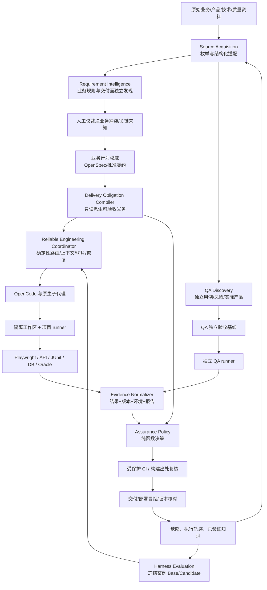

# ADS-ARCH-003｜下一代 AI 软件工程与可信交付系统——生态复核修订版详细设计

> **文档版本**：设计稿 3.0（2026-10-31；基于 ADS-ARCH-002 复核修订）  
> **状态**：生态复核后的研发基线候选，尚未实现；尚无开源集成 PoC、真实项目验收及最终架构冻结。  
> **设计范围**：全新工程或替换式开发均可，不预设继承 `ai-dev-template` 的实现。  
> **既有参照**：`ai-dev-template v5.6.47`、`AI-Delivery-System-Blueprint/01~03`、`10087.json` 的历史失败案例、2026-10-31 对 `didi/helixharness` 等公开源码及官方文档的核对。  
> **最高目标**：从原始需求到最终交付，使 **AI 正确理解要做什么、可靠地把工作做完、并通过独立证据证明产品满足确认的要求**。  
> **适用**：面向多项目复用的开源 AI 软件工程系统。通用工程绝不能内置具体业务公式、SQL、真实数据、真实环境凭据或业务页面；项目差异通过受控适配器接入。

---

## 0. 执行摘要与重大架构决定

本方案取消“先建立大量审批账本与门禁，再要求 Agent 完成流程”的设计惯性。系统不以 Requirement/Scenario 映射全绿、Agent 汇报完成或测试脚本存在作为交付完成依据。最终结果同时满足以下三条相互独立但关联的质量链：

1. **Requirement Intelligence（需求智能）**：从原始资料、既有系统与历史缺陷独立发现交付要求；声明发现范围与未知；将需要人做出的业务选择收敛到少量具体反例。
2. **Reliable AI Engineering（可靠 AI 开发）**：以 OpenCode 为首个生产宿主，确定性路由、按需加载经验证知识、按用户功能垂直切片实施、最小真实链路优先、子代理结果可复核、执行中断可恢复、失败有限自动修复。
3. **Delivery Assurance（可信交付）**：DEV 与 QA 分别形成验收预期和证据；通过真实 UI/API/DB 执行、独立 Oracle、风险分级、受保护 CI、构建/部署一致性给出有边界的交付判定。

**核心架构形态**：优先做“**一套轻量 CLI + OpenCode 原生执行 + 开源工具适配器 + 交付义务与证据的确定性薄内核 + 隔离评测基准**”。如 Harbor 等现成评测平台满足 PoC，就不另写评测调度器；如宿主原生机制满足恢复/路由，就不重造第二个 Agent Loop。可独立新仓开发，旧 v5.x 仅保留冻结对照基线。

**生态复核后技术决议**：OpenCode 为首选 Agent 宿主，OpenSpec 为首选规格权威；优先对 Harbor 进行独立评测平台 PoC，对 Playwright Test Agents（含 OpenCode 集成）进行 UI 测试生成/修复 PoC。以 HelixHarness、GSD、Open SWE、OpenHands、Superpowers 对照可靠性能力，只有原生能力确实缺位时才自研执行协调。真实验证复用 Playwright、JUnit/Testcontainers、Schemathesis、独立 QA 与受保护 CI。ADS 自研优先落在“跨来源交付义务与差集、外部验收契约、证据判定薄投影”。

**解释优先级**：第 17、18 章及独立的《专家架构复核与重大决议》是本次生态复核带来的修订决议；如与前 16 章的自研优先级或 M0 工作顺序存在歧义，按新版“先校准评测/验证上游能力、再最小自研”的规则执行。

**验收不承诺绝对无缺陷**：有限材料与测试不能数学证明全部需求被发现或所有未来行为正确。系统应明确 `UNKNOWN` 与范围、置信度、风险，使可被检出的遗漏在编码前或交付前尽可能暴露；未知不得自动放行。

## 1. 问题定义、实证与反目标

### 1.1 已观测的失败模式

| 失败模式 | 典型事实或现象 | 根本原因 | 新系统必须提供的反制 |
|---|---|---|---|
| 单一源头遗漏 | `10087.json` 相关开发曾出现“31/31 PASS，实际缺少基础字段、导出”等问题 | `grill-me` 摘要成为后续设计与测试共同唯一输入 | 源资料独立枚举 + QA 独立发现 + 来源→功能义务差集 |
| 局部通过代替整体可用 | 前端构建与后端编译成功，但页面、接口、数据库尚未贯通 | 在真实系统运行前并行完成多层技术任务 | Walking Skeleton + 真实跨层旅程 + 垂直切片完成判定 |
| AI 自出题自判卷 | 同一上下文产生预期、代码、断言和 PASS 报告 | 业务预期、测试执行和报告身份未分离 | 受控验收基线、独立 QA、外部 runner 与受保护 CI |
| 过程复杂、效果不明 | 多次审批由 `covers` 等技术定位变动触发 | 审批与真正业务判断价值没有对应 | 仅业务语义/高风险例外需要人工；技术调整自动校验 |
| 长任务执行不稳定 | 子代理完成局部代码却无法形成可运行结果；失败后重复尝试 | 缺乏产出契约、完整切片收敛与恢复点 | 任务结果契约、可恢复检查点、有限自愈、停止条件 |
| 历史知识重复丢失 | 新会话再次澄清已经确认的问题 | 会话摘要不是可验证项目知识 | 来源化知识库 + 索引 + 失效与重评估 |
| QA 聚合不严 | 同锚点 `PASS + PENDING` 可能被当成覆盖 PASS | 存在式聚合代替必验集合全称判定 | 基于已确认必验集合严格计算；QA 与 DEV 证据不能互替 |
| 门禁自身可被绕过 | Git post-commit 范围识别和自修改检查器存在潜在风险 | 被检查者可改变检查者；环境不稳定 | 独立信任根、提交范围负例、不可复用旧证据 |

以上案例是已有问题的工程诊断，并非声称每个缺陷已在本设计中被修复；所有改造必须由后续参考项目真实检验。

### 1.2 不能做的事

- 不用“再生成更细的 SPEC”取代原始证据发现；不要求业务人员给出字段级完整技术设计。
- 不用更多 Agent 或更多测试用例数量冒充独立性；不允许开发 Agent 自己批准业务 Oracle 或风险豁免。
- 不新造 OpenSpec、浏览器驱动、JUnit、编译器、AI 模型运行时、跨平台消息总线或常驻大型编排服务。
- 不把 CI/SHA/签名当作业务正确性的证明；它们只证明执行与出处层的命题。
- 不永久双运行 v5.x 与新系统、不为向后兼容保留已废弃的状态机；历史审计产物可只读归档。
- 不将 HelixHarness 全部源码和工作流照搬到 OpenCode；先验证集成方式和许可义务。

### 1.3 系统不变量

`I-01` **需求权威与实现分离**：代码和测试不能反向生成“已批准业务预期”。  
`I-02` **真实执行**：`PASS` 必须指向实际已执行测试、被测主体和原始报告。  
`I-03` **范围可解释**：未知、遗漏、无法解析、未执行不能自动解释为不适用或通过。  
`I-04` **任务可恢复**：重复调用同一任务不可重复破坏性执行；恢复前必须验证工作区和权威输入未漂移。  
`I-05` **独立验收**：QA 有自己的原始输入、必验集合、测试证据和结论，DEV PASS 不自动转换 QA PASS。  
`I-06` **可信决定**：AI 可建议结果和修复，但没有权力签署高风险例外、独立 QA 通过和最终发布授权。  
`I-07` **增量与隔离**：宿主/测试器/业务适配器可替换，真实业务数据不得进入通用框架。  
`I-08` **可证伪优先**：每个新增的硬检查必须有“刻意破坏后会失败”和“正常行为会通过”的真实反例。

## 2. 产品角色、用户旅程与完成定义

### 2.1 参与者与责任

| 角色 | 决定权与职责 | 不能做 |
|---|---|---|
| 产品/业务责任人 | 确认业务规则、关键示例、范围冲突与风险接受 | 不被要求签字每条技术测试定位 |
| 开发负责人 | 定义项目适配、技术决策、跨仓边界和执行资源 | 不凭“Agent 完成”批准交付 |
| 开发 Agent（DEV） | 发现候选、建议设计、实现代码、运行项目测试、自动修复 | 不修改已确认预期以使测试通过 |
| QA 责任人/QA Agent | 独立建立 QA 验收视角、评审用例、运行验收、提出缺陷 | 不复用 DEV 的 PASS 作为自己执行结果 |
| 安全/交付系统（CI） | 在受保护的信任域验证真实构建、测试执行和策略 | 不声称 CI 证明业务规则正确 |
| 用户/发布授权者 | 根据各维证据决定能否部署或接受风险 | 不被自动的 QA/AI 评分替代 |

### 2.2 首期支持的三类入口

**新功能**：`输入原始需求 → 发现/澄清 → 批准业务契约 → 切片实施 → 真实运行 → DEV/QA → 部署验证`。  
**疑似缺陷**：`真实复现 → 确认既有预期 → 调试 → 回归 → 受影响切片验证`；先走 systematic-debugging，必要时才进入新的业务需求澄清。  
**QA 反向入口**：`原始 QA 多 Sheet/历史缺陷/实际产品 → 用例质量审查 → 发现漏项/冲突 → DEV 修复或业务裁决 → QA 独立复测`。

### 2.3 完成定义

一个可交付切片必须能回答：需求来源是什么、预期经谁确认、用户怎样在真实系统完成、哪一段代码/哪个构建被测试、失败路径如何验证、QA 是否需要独立验收、是否仍有未知或风险。**技术任务完成 ≠ 用户切片完成 ≠ 可发布。**

交付报告分列 `requirements / engineering_execution / functional_behavior / runtime_usability / qa_independence / evidence_integrity / deployment_identity`，每项 `PASS | FAIL | UNKNOWN | NOT_APPLICABLE`；`N/A` 必须有确定的适用性证据及批准策略。`UNKNOWN` 不折叠成 PASS；整体 READY 由确定性策略计算，而不由自然语言 Agent 声明。

## 3. 总体架构与部署形态



### 3.1 四个横向工程内核，不等于四个部署服务

| 内核 | 自研范围 | 外部事实权威或运行引擎 |
|---|---|---|
| Discovery & Contract | 源对象清点、可见功能义务、来源差集、可再生派生视图 | 原始文件、Figma、OpenSpec、项目 API/路由 |
| Reliable Engineering | 任务契约、确定性选路、上下文索引有效性、子代理交付、检查点与恢复、有限自动修复 | OpenCode 原生 Agent/Skills/SDK、项目 Git/runner |
| Evidence & Assurance | 外部结果适配、构建/环境绑定、DEV/QA 多维决策 | Playwright/JUnit/OpenAPI/CI、项目独立 Oracle |
| Learning & Benchmark | 证实知识的升级/失效、框架对照实验、反馈分析 | Git、OpenCode 导出/SDK、测试报告、HelixHarness 评测思想 |

模块默认在一个轻量 CLI 进程中以稳定接口组合，**不默认引入 Kafka、中央数据库、Web 平台或新的远程 Agent Server**。执行过程需要持久化时使用项目本地 checkpoint 文件与原子写入；跨团队规模达到真实需求后再评估中心服务。

### 3.2 参考工程目录（待实现）

```text
ai-delivery-system/
  ads/                      # CLI 和确定性协调核心
    discovery/              # 来源适配 + 交付面独立发现
    contract/               # 只读交付义务编译器
    engineering/            # OpenCode 宿主适配、任务协议、恢复与上下文
    assurance/              # 标准证据解析与纯函数判定
    knowledge/              # 经过确认的知识索引与失效策略
    benchmark/              # 冻结任务集、对照执行和评估
    adapters/               # openspec, git, qa-sheet, junit, playwright, ci 等
  schemas/                  # JSON Schema，向后可版本演进
  policies/                 # 精简风险/适用性默认策略
  .opencode/                # 原生 Skills/Commands（仅薄入口）
  examples/reference-app/   # 完全虚构的可运行 UI+API+DB 工程
  tests/                    # 单元、集成、契约、恶意与真实故障注入
  docs/                     # 当期说明与 CHANGELOG
```

项目接入只需 `ads.project.yaml`（项目 Profile、启动和测试命令、UI/API/DB 路径、CI 配置）及必要的 `docs/project/` 领域来源/Oracle。该配置不能存密钥。OpenCode 侧原生入口优先位于 `.opencode/skills/...`；兼容其他宿主时只委托同一规则，不维护第二份全流程文档。

### 3.3 工具/权限边界

- 解析器、网络资源、源文档、代码注释均是低信任输入，不能提升权限或改变规则。
- OpenCode Agent 通过宿主的 `permission` 规则控制读写、bash、子代理和外部目录权限；正式环境不允许无审查执行破坏性操作。
- 项目测试跑在隔离容器/工作区，网络、CPU、时间与文件权限设限；不能将 CI 策略和独立 Oracle 放入同一业务 PR 的可修改授权范围。
- 只在可靠性评测确实要求时接入 OpenHands SDK 等第二运行时；首版不自研 Agent Loop。

## 4. Requirement Intelligence：如何从最原始材料得到完整交付义务

### 4.1 原始资料与权威等级

| 输入 | 读取方法 | 可发现的事实 | 不可直接推断 |
|---|---|---|---|
| 原始 PRD/合同/业务邮件 | 保留文件 SHA、页/段定位；结构化读取及附件盘点 | 规则、定义、约束、责任人/争议 | 原文未覆盖的产品行为 |
| 原始 Excel | `openpyxl` 枚举 Sheet（包括隐藏页）、公式/批注/数据有效性/合并单元格 | 计算候选、异常示例、数据格式 | 缓存值等于公式计算正确；历史结果等于权威 |
| Figma/线框图/截图 | 优先 Figma Node API、图片分区识别与人工抽样 | 页面、字段、按钮、状态、视觉结构 | 全部动态行为由截图决定 |
| 录屏/操作记录 | 用户动作、事件时间戳、系统响应与异常 | 实际存在的用户旅程、缺失状态 | 现有系统行为一定正确 |
| 现有代码、API、DB、Git | 路由/菜单、Controller/OpenAPI、迁移、变更历史 | 现有交付面和潜在影响 | 代码是真正的业务预期 |
| 历史缺陷/QA/监控 | 原始 Bug、复现步骤、版本、失败原因 | 反例、遗留风险和回归重点 | 每个 Bug 描述都代表未来契约 |

三层分类：`OBSERVATION`（观察到的原始事实）→ `CANDIDATE`（AI 的假设）→ `CONFIRMED`（有权主体确定的契约）。只允许最后一类用于需要业务定值的关键 Oracle；真实来源缺失则报告 UNKNOWN 并揭示受影响范围。

### 4.2 两条相互挑战的发现路径

**业务/行为发现路径**：EventStorming 建事件时间线，Example Mapping 将故事拆成规则、例子、反例和问题；`grill-me` 只询问真正影响业务决定的未知项，不重新展开已证实的知识。  
**交付面/验收发现路径**：直接从线框图/路由/API/表单/操作录屏提取页面、字段、控件、数据来源、权限、加载/空/失败状态；从 QA/历史 Bug 补充负例。二者可使用不同 Agent 上下文，但独立性来自**不同源头与确认权限**，不是模型数量。

### 4.3 完整性算法（限定已盘点来源，不能宣称无限完备）

```text
1  inventory = enumerate(all supplied sources, every file/sheet/frame/page/attachment)
2  observation = extract_with_locator_and_errors(inventory)
3  scope = reconcile(observation, existing_spec, ui_routes, api, database, qa_sources)
4  obligations = compile_read_only(confirmed_contract, observed_delivery_surfaces)
5  gaps = source - confirmed_scope
          + confirmed_scope - accepted_verification
          + implementation_changed - verification_coverage
          + qa_independent_requirements - qa_must_run_cases
6  unresolved = unreadable + ambiguous + inconsistent + unreviewed + missing_access
7  readiness = (no blocking gaps) AND (critical unknowns resolved or explicitly accepted)
```

**防漏机制**：不能由 `test-plan.covers` 决定是否存在 UI；必须独立扫描 Git 的 UI 变更、路由与菜单。针对“没有被任何 Agent 提取出来的字段”，源盘点应报告每张图、每个 Frame、每个 Sheet 的提取/复核范围；重要来源抽样或人工确认边界，无法确定则 UNKNOWN。抽样不能保证所有未提供资料已发现，明确报告限制。

### 4.4 业务澄清策略

- 仅对规则冲突、预期结果未知、权限/金额/不可逆写入等高风险未决问题请求人工决策。
- 每个问题包含原文定位、具体正常实例、边界或反例、两个可选解释及影响范围；用户只需裁决语义，不签整个 Markdown。
- 如变更来自真实缺陷，先定位并证明已确认预期，不默认完整业务访谈；如发现规则变化，再走 OpenSpec 更新。
- 所有业务确认与例外附来源、确认身份和范围；仅 Git `user.name` 不算独立权威身份。

## 5. Delivery Contract：可执行义务，而非另一套业务规格

一项“交付义务”是**为证明已确认功能确实可用而必须满足的可观察条件**，不是新的业务规则来源。例如“选择对象后展示七个只读字段”“提交后查询到持久化数据”“导出 XLSX 物理文件中存在要求列”。

### 5.1 派生契约数据模型

```json
{
  "schema_version": "ads-obligation/v2",
  "id": "obl-demo-ui-001",
  "source": [{"uri": "docs/project/source/wireframe.png", "sha256": "<digest>", "locator": "screen-A/panel-2/field-3", "status": "REVIEWED"}],
  "behavior": {"authority": "openspec", "scenario_id": "SCN-DEMO-001", "contract_digest": "<digest>"},
  "observable": {"kind": "ui-field", "route": "/demo/view", "element": "creationDate", "expected": "真实接口数据映射，显示为只读字段"},
  "verification": {"kinds": ["browser-e2e", "api-contract"], "risk": "L2", "qa_must_run": true},
  "status": "CONFIRMED"
}
```

此文件由受控源和 OpenSpec 编译产生，**只读、可删除重建**；不存在“人工在第二份规格里改业务预期”。不含 `CONFIRMED` 的候选只能展示缺口，不可冒充已确认的行为。统一摘要绑定来源、场景语义、风险策略，所有执行结果仍必须绑定完整物理计划/代码版本。

### 5.2 项目交付面（Delivery Surface）

以页面、路由、字段、操作、API、读写数据、权限、导入导出、错误/加载状态组成可枚举的范围。`source → obligation` 发现从未注册的需求；`change → obligation` 发现未经验证的实现；`obligation → evidence` 发现已承诺但未执行的验收。

不要求每个字段对应独立人工审批或独立测试文件；一个真实浏览器旅程可包含多个可核验断言。重要的是能追到每个必需行为及结果，而不是统计测试数量。

## 6. Reliable AI Engineering：让 AI 的开发过程本身可靠

这一部分与交付保证**同等优先级**，不能仅靠更多提示词解决。核心交互由确定性控制器选择，AI 对开放性决策进行推理。

### 6.1 确定性任务路由

建议首版目标入口（**为设计示例，尚未存在 CLI**）：

```bash
ads discover --change <id>           # 盘点原始输入、风险与遗漏
ads develop --change <id>            # 运行可恢复的垂直切片开发
ads verify --change <id>             # 聚合真实执行与完整性结果
ads qa --change <id>                 # QA 独立接入和反向验收
ads benchmark --suite <suite>        # 冻结案例评测 Harness
ads status --change <id>             # 阻断、证据、恢复指引
```

OpenCode 原生 `/opsx:*` 命令属于 OpenSpec 权威，不覆盖、不复制；ADS 仅通过 `.opencode/skills`、薄命令或官方 SDK 调用相应阶段；根据输入判定 `new-feature / bug-fix / qa-intake / review / recovery`，返回明确的下一动作、输入、允许工具和停止条件。**不能让 Agent 靠猜测当前应该运行哪个脚本。**

### 6.2 按需上下文与知识失效

借鉴 HelixHarness `docs/knowledge`、`docs/harness` 索引及阶段按需加载思想，但必须避免“未索引文件永久不可见”的失败模式：

1. 项目根入口保留最少的不可变工程约束和索引位置；每个切片加载当前业务规则、架构边界、相关代码/历史缺陷，而不是全量文档。
2. 索引定期从真实 Git 文件树自动盘点；新增未索引且可能相关的文件产生 `CONTEXT_DISCOVERY_GAP`，不能静默跳过。
3. 每次加载记录 `path + content_sha256 + authority + relevance_reason`；续接时比较真实内容哈希及 Spec/Git 基线，变化则精确失效并重读，不单依赖时间戳。
4. 区分 `CONFIRMED_KNOWLEDGE`、`WORKING_HYPOTHESIS`、`OBSOLETE`；历史知识必须绑定来源、适用范围和失效条件。
5. Archive 只提出知识提升候选；安全/业务不变量需有明确权威确认，自动生成的错误推断不得沉淀为永久规则。

### 6.3 垂直切片与子代理交付契约

**先 Walking Skeleton**：隔离环境启动前后端/DB → 登录 → 打开路由 → 真实 API → 数据查询 → UI 展示。未跑通时禁止大规模并行实现后端和前端并宣称功能完成。

子代理可以处理前端、Java、测试、数据库、文档等不同任务，但每个任务必须有机器可读的：

- 输入：确认的业务 Scenario/义务、允许修改的路径、工作区与基线、所需能力及测试命令。
- 输出：变更文件、Git 差分、实际运行命令/退出码、证据引用、已知缺口、合并冲突、建议下一个步骤。
- 完成要求：父任务对切片所需的 UI/API/DB 结果做集成复核；子代理 `done`、文本总结或文件存在不得自动升级为切片 PASS。
- 独立性：同一测试预期不得由正在修改实现的子代理临时重写；关键 Oracle 保持独立冻结。

**并发边界**：允许只读扫描/独立模块测试并发；同一 Git 工作树上的写入任务串行，或使用明确隔离 worktree；多仓依赖使用每仓 commit SHA 和依赖图，合并后必须重新执行跨仓旅程。

### 6.4 可恢复执行：检查点而非第二套审批状态机

一轮长任务的持久化记录只保存**执行事实**，不重建 OpenSpec/QA 业务审批状态：

```json
{
  "schema_version": "ads-run-checkpoint/v1",
  "run_id": "run-demo-0001",
  "task_id": "slice-demo-A",
  "intent_digest": "<digest>",
  "spec_digest": "<digest>",
  "workspaces": [{"repo": "frontend", "base_commit": "<sha>", "current_commit": "<sha>", "dirty_fingerprint": "<digest>"}],
  "last_completed_step": "api-contract-test",
  "executed_actions": [{"action_id": "act-23", "idempotency_key": "<digest>", "result_ref": "results/api-23.json"}],
  "pending_action": "browser-e2e",
  "blocker": null
}
```

- **原子写入**：写到临时文件并 fsync/rename；写入前检查 source/Spec/worktree 指纹，避免覆盖并发修改。
- **安全续接**：继续前复核所有权威输入；漂移则 `REPLAN_REQUIRED`，不得回放旧测试结果。
- **副作用管理**：对于建表、修改文件、启动服务等行动设幂等键/补偿策略；不重复执行已成功的不可逆步骤。
- **失败隔离**：工具错误、环境错误、业务断言失败、冲突与权限拒绝分别处理；权限拒绝不能通过换工具绕开。
- **停止条件**：同一根因自动修复至多建议 2 次（项目可配置），或到达资源预算/证据不足/业务语义冲突时停止并给出最小诊断，不无限循环。

### 6.5 自主修复与最少人工介入

```text
运行失败 → 解析真实错误与证据 → 归类
  ├─ 环境/依赖：调整可重试环境 → 定向重跑
  ├─ 已确认行为被违反：systematic debugging → 最小补丁 → 回归 + 真实切片复验
  ├─ 测试实现错误：修复测试机械问题，不能改已批准预期 → 重跑
  ├─ 需求冲突：生成最小示例/两种解释 → 请求业务裁决
  └─ 权限/敏感或不可逆操作：停止 → 交由授权主体
```

对每次自动修复记录变更摘要、测试前后对比、根因假设与当前可重复失败；若修复未改善结果，回退修复尝试或停止，不能通过移除断言、Mock 实际 API、改变期望数据来获得绿色结果。

### 6.6 执行权限与人机协作

- Agent 默认可读仓库、在隔离工作区写入、运行预先声明的开发/测试命令。
- 涉及生产网络、秘密、删除、数据迁移、受保护目录和策略修改时要求外部授权；受保护 CI 的规则不可由业务 PR 修改并自批。
- 人工只裁决业务语义、风险例外、不可逆操作或真正的设计权衡；纯格式、定位、重复日志和常规重试自动处理。
- 运行时应输出当前已验证切片、阻断原因及下一条可操作命令，而不是让用户在多份台账中寻找状态。

## 7. Delivery Assurance：真实功能、独立 QA 与交付证据

### 7.1 先定义执行层级，再绑定真实测试器

| 义务类型 | 默认可采用的专业工具 | 真实通过的条件 |
|---|---|---|
| UI 交互和功能完整性 | Playwright `webServer`、Trace、downloads、Test Agents（planner/generator/healer） | 正式断言必须映射至只读验收基线；真实浏览器+服务；字段/按钮/下载可观察；healer 不得降级预期 |
| 前后端契约 | OpenAPI 响应 Schema、Schemathesis；多服务可选 Pact | 消费端关键字段与提供端真实响应一致；200 占位实现不会通过 |
| 数据与事务 | JUnit + Testcontainers / 项目已有集成测试 | 真数据库中读写、回滚、幂等/约束正确 |
| 核心业务规则 | 项目侧独立 Oracle、性质测试、选择性变异测试 | 断言源与实现分离，有可解释的输入/输出与反例 |
| 页面视觉 | 可选截图对照或设计节点比对 | 只证明视觉，**Mock 视觉 PASS 不等于真实 API 或业务 PASS** |
| QA 独立 | QA 多 Sheet、既有用例评审和独立环境 | 必验集合逐用例执行/处理，不能由 DEV 结果替代 |
| 发布和运行 | 受保护 CI、构建/部署摘要、部署后冒烟 | 受信任执行者对确切交付产物重跑验证且版本一致 |

### 7.2 QA 反向发现与职责隔离

- QA 输入至少含：QA 原始用例（模块多 Sheet）、原始需求/截图、历史缺陷和被测系统；**不得仅从 DEV Scenario 派生 QA 用例**。
- 质量审查与需求一致性审查分开；自动辅助映射，QA 不必手写 Requirement ID。
- 把遗漏分为 `REQUIREMENT_GAP / IMPLEMENTATION_DEFECT / QA_CASE_DEFECT / ENVIRONMENT / TEST_INFRA / SPEC_CONFLICT / OUT_OF_SCOPE`，只对确需改变已确认业务预期的部分进行人工复审。
- 发布必验集合 `R` 由已确认 QA 范围生成：`QA_PASS ⇔ ∀ r∈R, verified(r, subject, case_version) ∧ current_evidence(r)`；若有 `PENDING/FAIL/NOT_RUN` 则不是 PASS。例外是具有明示权限、范围及有效期的风险接受，不能隐式 N/A。
- QA 可在独立构建/环境完成测试，但最终对账必须明确该构建与交付构建的等价/一致性证据；修复后 QA 在新构建上复测，不能用旧 PASS 关闭缺陷。

### 7.3 证据归一化与对象绑定

```json
{
  "schema_version": "ads-evidence/v2",
  "run_id": "ci-run-100",
  "producer": {"runner": "playwright", "runner_version": "<version>", "trust_level": "CI_VERIFIED", "identity": "<protected-ci-id>"},
  "subject": {"repos": [{"name": "frontend", "commit": "<sha>"}, {"name": "backend", "commit": "<sha>"}], "build_digest": "sha256:<digest>", "deployment_digest": "sha256:<digest>"},
  "test": {"id": "e2e/demo-journey", "result": "PASS", "exit_code": 0},
  "contracts": {"obligation_ids": ["obl-demo-ui-001"], "acceptance_digest": "<digest>", "qa_case_digest": "<digest>"},
  "environment": {"profile_digest": "<digest>", "data_profile_digest": "<digest>"},
  "artifacts": [{"uri": "evidence/playwright-trace.zip", "sha256": "<digest>"}]
}
```

**原始证据优先**：必须保留/可查报告和日志，归一化结果是事实投影。缺失运行身份、日志或退出码的声明最多是未验证候选；简单 `assertion_ref` 静态字符串不能生成 PASS。任何源码、测试、契约、工具或环境关键指纹漂移，先前结果必须重新评估适用性。

**信任等级与正确性相互独立**：`LOCAL_UNTRUSTED / CI_VERIFIED / ATTESTED` 只表示“谁执行与如何核查”，不是业务 PASS；CI SHA 与签名也不能证明测试预期本身正确。

### 7.4 确定性决策规则

```python
# 仅算法示意；不是已实现代码。
def delivery_ready(report, policy):
    required = policy.required_dimensions(report.change_risk)
    return all(report.dimensions[d] == "PASS" for d in required) \
        and report.subject_identity_verified \
        and not report.blocking_unknowns \
        and not report.active_unapproved_exceptions
```

- 所有维度 `PASS / FAIL / UNKNOWN / N/A`；`N/A` 的理由和批准策略必须能外部核查，不能任由 Agent 填写。
- 风险策略以受影响业务不变量为先：财务金额、权限、隐私、持久化、不可逆操作、跨系统状态为高风险候选；AI 可以提出升级，不能无依据降级。
- DEV 验证和 QA 验证分别显示，未要求 QA 的项目可以有明确策略，但不能把 `QA_NOT_RUN` 隐去。
- 每次阻断必须报告可复现的错误类别、被检查主体、原始报告路径和最小恢复动作。

### 7.5 可信 CI 与自修改攻击

- 受保护 CI 的执行规则、参考验收、关键策略与业务 PR 分属不同信任边界，必要时通过受保护分支/固定检查器镜像实现。
- 对“提交后 Git changed_files 为空”“删除断言”“修改 Gate 默认放行”“复用旧构建 PASS”“更换 QA case 版本”做恶意反例。
- 所有跨仓库修订、构建摘要、镜像摘要和部署对象必须一致或有明确映射；部署后再跑冒烟测试。
- 若项目没有受保护的执行方，最多报告 `DEV_VERIFIED_LOCAL`，不能宣称发布级可信；本地文件自己签名不增加信任等级。

## 8. Learning & Benchmark：Harness 自身也必须可检验、可演进

这是借鉴 HelixHarness 最重要的部分：**评测对象不只是业务代码，还包括 AI 工程系统的 Skill、工作流、上下文策略与 Agent 协作机制本身。**

### 8.1 版本对照实验

```text
冻结原始需求包 + 起始代码 + 运行环境 + 隐藏验收案例
       ├─ Base：旧框架或已发布稳定版
       └─ Candidate：新 Harness / 变更后的路由、知识、流程
       ↓ 隔离工作区、相同模型/预算/任务边界、多次重复
       ↓ 独立可执行评分 + 少量有审计轨迹的专家复核
       ↓ 对比：功能交付、可靠开发、成本、返工、误报
       ↓ 仅证明改善后接受候选；否则回滚
```

冻结 Case 至少包含两种：**公开训练/调试集** 和 **隐藏保留集（Holdout）**，防止 Harness 为熟悉的负例量身定做。每个 Case 有独立原始来源、预期缺陷、Golden Path、故障注入脚本与正确判定条件。每个版本按同一固定镜像/配置、相同模型和资源预算比较；模型升级与 Harness 升级分别做因子实验，避免混淆因果。

### 8.2 三组必须分开报告的质量指标

| 目标 | 主要指标（都有真实运行分母） | 不接受的替代指标 |
|---|---|---|
| 需求理解 | 来源义务漏检率、关键未知暴露率、与业务确认的有效冲突检出率 | 生成多少 Requirement |
| AI 开发可靠性 | 首次切片成功率、自动恢复成功率、无关修改率、工具错误率、上下文漂移事故、每切片人工介入 | Tool calls、Subagent 次数 |
| 最终交付质量 | 真实旅程通过率、已注入缺陷检出率、QA 缺陷逃逸率、构建/部署一致率、首次可用率 | `31/31`、文件/覆盖率数字本身 |

上层再统计全链路“每个已确认切片首次独立验收通过的成本、时延及修复轮数”。指标不能只比较单个成功案例；必须包含失败、重试、运行成本、统计区间和置信限制。强制显示未知案例占比；不能为了提高通过率选择性剔除失败样本。

### 8.3 可验证知识沉淀

- Archive 后由工程系统建议保留 `规则、接口边界、可靠排障手法、重复 QA 问题`，必须附原始来源、验证结果、适用项目/版本、负责人确认、失效条件。
- 知识并非越多越好：过期或冲突先失效，保留可追溯历史；不能通过只读索引把未经检验的 Agent 结论升级为真相。
- 每次 Harness 修改引发的评测差异和失败轨迹都作为下一轮改进输入；可以先离线分析 OpenCode 会话 JSON、Git 和 CI，不需要常驻观测服务器。

## 9. 标准接口与最低兼容契约

### 9.1 核心接口（语言无关伪定义）

```text
SourceAdapter.enumerate(root) -> SourceObject[] | Errors
SourceAdapter.extract(object) -> Observation[] + CoverageBoundary
ContractReader.load(change) -> ApprovedBehaviorBaseline
ObligationCompiler.compile(source, baseline, surfaces) -> DerivedObligation[] + Gaps
SurfaceScanner.scan(base, head, projectProfile) -> DeliverySurface[]
EngineeringHost.start(task, workspace, permissions) -> SessionRef
EngineeringHost.resume(checkpoint, expectedFingerprints) -> SessionRef | ReplanRequired
TaskExecutor.run(slice, projectProfile) -> RawRunArtifacts
EvidenceAdapter.normalize(raw, subject, policy) -> Evidence | InvalidEvidence
QACaseReader.load(sheets) -> QACaseBaseline + MustRunSet
AssurancePolicy.evaluate(obligations, qa, evidence, identity) -> MultiDimensionalDecision
BenchmarkAdapter.compare(frozenSuite, base, candidate) -> Report  # 优先 Harbor；不默认自研评测执行平台
```

协议先落为 JSON Schema + CLI stdout JSON + 标准退出码（0 正常、2 验证失败、3 输入/基线未知、4 环境错误、5 权限拒绝；准确含义由实现后固定），而非依赖大规模进程内集成。错误不得被统一吞并为 `PASS_WITH_WARNING`。跨语言适配与宿主 SDK 由接口隔离，避免把某个 OpenCode 版本的内部 Session JSON 结构当永久接口。

### 9.2 配置与事实边界

- `ads.project.yaml`：项目性质、代码仓、启动/测试命令、受控环境、UI 路由/APIs、QA 位置、执行预算及可信 CI 策略引用；不能写业务预期、真实 SQL/密码。
- OpenSpec `specs/changes`：业务行为权威；ADR/设计选择仍可通过项目文档表达。
- `docs/project/`：项目业务原始来源、知识、领域 Oracle 入口和项目 Profile 说明；真正含敏感资料的文件不要求复制进公开仓库。
- `.ads/runs/<id>`：临时执行检查点、真实日志/引用与机器报告；不可作为另外一份人维护的需求/QA 账本。
- QA Excel 多 Sheet：用例原始来源和独立 QA 决策；机器索引/关联属于可重建投影。

## 10. 风险、隐私、可靠性与可扩展性

### 10.1 主要威胁

| 威胁 | 控制 | 验收反例 |
|---|---|---|
| 原始文档提示注入 | 文档作为不可信数据、解析器沙箱、工具权限不被内容覆盖 | PDF 试图命令 Agent 关闭 Gate，实际无法执行 |
| 业务测试自证 | 受控期望来源、独立 Oracle、只读验收基线 | 实现 Agent 修改预期 → CI 或契约校验失败 |
| 工作区/跨仓漂移 | commit/diff/dirty 快照与乐观锁、隔离 worktree | 同时修改文件时，恢复必须阻断或重新规划 |
| 无限修复循环 | 有界重试、不同失败类型策略、成本预算与停止条件 | 两次同根因失败时退出并诊断 |
| 假绿及证据污染 | 真实结果/版本绑定、独立 CI、反例测试 | 旧 PASS 换成新构建标签时失败 |
| 解析敏感文件外传 | 默认本地解析、最小权限、脱敏、凭证隔离与保留期 | 原始文件含 Token，最终报告不得泄露 |
| 选型失控 | 插件显式能力边界、默认最小依赖、PoC 退出方案 | 关闭可选插件时核心判定仍稳定 |

### 10.2 非功能指标（初始目标，需 M0 基线校准）

- 同一来源及配置下，核心派生义务和判定必须确定性重复；需要 AI 的候选发现阶段允许差异，但输出可比较且需受控审阅。
- 失败与中断不丢失已完成的独立执行事实；恢复后若源或工作区变化，禁止套用旧检查点。
- 每次诊断必须在报告中定位来源、错误类型、命令、日志和恢复建议；不要求用户翻查多个审批 JSON。
- 默认支持单仓/多仓的目录/Profile，CI/容器在项目侧配置；不强求一套技术栈。
- 资源预算与失败重试上限由项目配置；L3 任务需要更严格的执行、授权与风险审计。

## 11. 成熟开源产品的采纳与退出策略

| 产品/方法 | 决定 | 直接借鉴/复用 | 不采用或必须 PoC 的内容 |
|---|---|---|---|
| **Harbor** | M0 优先接入 PoC | 自定义任务、Agent 适配、隔离评测和结果收集 | 禁止先造重复评测平台；依赖和 OpenCode 兼容必须实测 |
| **Playwright Test Agents** | 有 UI 项目优先 PoC | planner/generator/healer，明确支持 OpenCode | 正式 Oracle 由独立方冻结；healer 不得删除验收或使用 Mock 替代真实链路 |
| **GSD / Open SWE / BMAD / Spec Kit** | 针对性能力比较 | 新上下文波次、持久开发、需求角色分离、实现收敛 | 不装四套竞争的工作流；复用协议和方法而非整套状态 |
| **Opik / Phoenix** | 可选观测 PoC | trace、数据集、实验、Agent 可观测性 | 首版无必要不部署；Phoenix ELv2 需许可复核 |
| **OpenCode** | 首期主开发宿主 | 原生 Skill、Agent/Subagent、permission、SDK/会话能力 | 不写第二套 Agent Loop；SDK 稳定性与导出字段做契约验证 |
| **OpenSpec** | 首选业务规格权威 | `explore/propose/apply/verify/archive` 和批准业务规格 | 不重写独立 SPEC 状态机；不覆盖其官方命令 |
| **HelixHarness** | 核心借鉴 + 代码复用 PoC | 知识索引、确定性路由、检查点/多仓、双轴评审、冻结版本框架评测 | 当前正式宿主 Codex/Claude Code；不直接复制相竞的规格工作流；平台先对照 PoC |
| **Superpowers** | 方法与 Skill 候选 | systematic-debugging、TDD、code-review、subagent execution | 若和 OpenSpec/ADS 命令重复，保留单个真正调用入口 |
| **Playwright** | UI 项目默认 | 真实 E2E、webServer、Trace、下载与视觉验证分层 | Mock 视觉 PASS 不能代表真实业务 PASS |
| **OpenAPI + Schemathesis** | API 项目优先 | 响应契约和异常输入/性质测试 | 多服务独立发布才考虑 Pact，避免重复投入 |
| **JUnit + Testcontainers** | Java/DB 项目优先 | 真 DB、事务/约束/回滚、隔离环境 | 项目根据数据栈安装，框架不放具体业务 SQL |
| **jqwik / PIT** | 高风险项目可选 | 性质测试、变异测试验证断言检错能力 | 不对普通 UI 文案每次跑全量 PIT |
| **OpenHands SDK** | 可选备用运行时 | 临时工作区、Agent/工具/事件界面 | 没有明显增益不引入第二个执行平台 |
| **in-toto / CI attestation** | 发布级可信可选 | 构建主体与身份、产物声明 | 不凭自签文件提升信任等级 |
| **OPA / Dagger / Backstage** | 后续规模化可选 | 策略分离、容器化流水线、Golden Path | 首版不建大型服务或多套重复状态 |

### 11.1 HelixHarness 具体复用评估

PoC-HELIX-01：读取其实际 `workflow_router` 与工作区基线机制，抽象为可在 OpenCode 调用的确定性接口；评估是否存在重复 Spec/审批职责。  
PoC-HELIX-02：使用相同案例、冻结 Base/Candidate、确定性评分和有限专家评阅比较本系统两个 Harness 版本；仅测试评测模块，不部署全平台。  
PoC-HELIX-03：知识索引、归档更新与会话续接在真实修改、源漂移、缺索引时是否给出正确行为。  
PoC 记录实际许可证、版本/提交、依赖、修改范围、测试报告与退出路径；**架构借鉴不等于源代码已经复用，也不意味着其平台已有我们的业务质量指标。**

## 12. 从零开发、替代迁移与不兼容政策

1. 新系统先在独立新工程中进行 M0 基准与首个切片开发；现有 v5.6.47 保留不可变对照包及可追溯 CHANGELOG。
2. 迁移只读取旧 OpenSpec 业务基线、QA 原始 Excel 和有来源的稳定知识；旧审批流水仅归档为历史事实，不复制旧 QA 状态机和 legacy-exempt 放行路径。
3. OpenCode 的 `.opencode/skills/skill-router/SKILL.md` 是用户明确维护的权威入口：若在原仓库集成，只能以当前文件增量合并；新仓可以设计新权威入口，迁移时先检查并保留人工更新。
4. 迁移采用 shadow read/差异报告，成功后一次切换正式命令；**不保持两个系统长期双写和同时判断 READY**。
5. 每个正式软件交付必须使用独立、严格递增版本号、独立 ZIP、增量 Diff、文件变更统计、CHANGELOG 与验收报告；README/AGENTS 只描述当前能力而不写版本历史。
6. 任何架构替换的前置条件是相同参考任务与故障注入下，检错能力不退化、交付首次可用率不退化、开发恢复性改善，且重复审批/状态机/脚本减少。

## 13. 实施里程碑、依赖与验收关口

| 阶段 | 交付内容 | 主要通过条件 | 失败则如何处理 |
|---|---|---|---|
| **M0 评测基础** | 虚构原始需求、可运行 UI+API+DB、Golden Path、双向校准故障案例、Harbor/Playwright Agent PoC | 正确参考实现 PASS、空补丁 FAIL、干净镜像重评一致、正常路径通过；有可复现对照 | 暂停抽象引擎开发，修正基准/工具 |
| **M1 需求智能** | 来源枚举、结构化解析、双路径发现、缺口与 UNKNOWN、澄清/只读契约 | 完整漏字段、漏按钮、漏路由在编码前被发现 | 不扩大功能，先改发现机制 |
| **M2 可靠开发** | OpenCode 原生路由、知识索引、工作区/子代理契约、检查点恢复、垂直切片/有限修复 | 中断可恢复、源漂移阻断、子代理不假完工、基本功能首次可运行 | 回滚选用的 Agent/并发策略 |
| **M3 真实验收 + QA** | Playwright/API/DB/Oracle 适配、QA 反向发现/必验聚合/新构建复测、证据归一化 | 页面/API/保存/导出负例失败、QA PASS+PENDING 阻断 | 不升级发布级 READY |
| **M4 可信交付** | 独立 CI、外部策略、构建/部署关联、部署冒烟、攻击反例 | 旧 PASS、Gate 自改、假 SHA 无法放行 | 降级本地可信等级，禁止声称受信交付 |
| **M5 真实试点与替换** | 同一需求的 Base/Candidate 实际对照、性能/人工负担评测、迁移、删除旧核心 | 需求发现、开发可靠性、交付质量三轴均有证据，未退化，迁移可回退 | 保留旧基线、不替换 |

每阶段不得仅以 Markdown 完成作为验收。**每个里程碑都必须运行真实 Golden Path、相关反例，并将失败原因与范围绑定实际代码和可重放环境**。M0/M1 最先交付可重演的实验，不先开发一堆抽象审批脚本。

## 14. 可证伪的统一验收案例（必须维护稳定基准）

| ID | 故意注入或真实条件 | 正确检出行为 | 主要验证轴 |
|---|---|---|---|
| F01 | 源线框图要求字段，OpenSpec 与测试均漏该字段 | 来源缺口，不能算完整 | 需求 |
| F02 | 完全新增 UI 路由，不登记 `covers` | 独立变更/路由扫描检出 | 需求/交付 |
| F03 | API 200，仅返回 ID，缺其他必需字段 | API 契约/真实 E2E 失败 | 交付 |
| F04 | 前端打包通过但页面运行时报错 | 浏览器旅程失败，保留 Trace | 交付 |
| F05 | 按钮缺失或启用时机错误 | 用户操作验收失败 | 需求/交付 |
| F06 | 数据保存返回成功但未持久化 | 真 DB 或保存后重载失败 | 交付 |
| F07 | 下载可触发但 XLSX 缺列/空数据 | 下载文件内容断言失败 | 交付 |
| F08 | QA 必验两个用例，一条 PASS 一条 PENDING | QA_NOT_VERIFIED | QA |
| F09 | 复用旧提交/旧构建测试结果 | STALE_EVIDENCE | 交付 |
| F10 | AI 修改 Gate 使错误通过 | 受保护 CI 拒绝 | 交付 |
| F11 | 会话中断，工作区未变 | 只恢复待办步骤，不重做副作用 | 开发可靠性 |
| F12 | 会话中断后 Spec/Git 发生漂移 | REPLAN_REQUIRED，不复用旧证据 | 开发可靠性 |
| F13 | 子代理声称完成但没有真实运行报告 | 切片仍 NOT_VERIFIED | 开发可靠性 |
| F14 | 工具持续返回相同环境故障 | 有限重试后明确阻断和诊断 | 开发可靠性 |
| F15 | 检索索引漏掉新加入的关键规范 | CONTEXT_DISCOVERY_GAP | 开发可靠性 |
| F16 | 测试断言人为删掉关键失败路径 | 变异/恶意反例发现弱测试 | 开发/交付 |
| F17 | Figma/Excel 来源无法读取 | SOURCE_UNKNOWN，不伪造扫描完成 | 需求 |
| F18 | 原始文档包含恶意工具调用指令 | Agent 不提高权限，不泄漏密钥 | 安全 |
| G01 | 完整真实用户旅程（UI→API→DB→导出） | 各必要维度 PASS，能够取得真实文件 | 三轴 |
| G02 | 健康的 QA 全部必验用例完成 | QA 结果与同一构建绑定，独立 PASS | QA |

F01 与 F02 主要验证“完全没有被登记的内容”，F11-F15 主要验证“AI 本身开发不可靠”，F03-F10 主要验证“交付结果假绿”。**不能只注入 JSON 造失败，要真实修改参考系统或执行隔离的信任攻击**；每个 Case 配置 `expected_detector` 和误报正例。

## 15. 研发定义完成、量化门槛与验收报告

### 15.1 阶段完成最低门槛

- 已实现代码、真实执行日志、输入/代码/测试/环境版本、失败和修复轨迹可复查；不会因为“文档已生成”而标为完成。
- 当前阶段所有指定严重故障注入均被正确检出（零关键已知漏检），且 Golden Path 通过；新增未知和误报必须如实公开。
- 相关正常正例在与负例同样的策略下不会被无故阻断；不能用“一概失败”获得 100% 漏检检测率。
- 自动恢复任务能验证不重复执行副作用并拒绝源漂移；敏感操作不被 Agent 绕过。
- QA/DEV 的身份、材料与执行证据独立，且不覆盖彼此的未完成项。
- 每个发布版本有明确验收报告、变更摘要、可回退路径和与基线的实测差异。

### 15.2 对照评测指标定义

- `已注入缺陷检出率 = 被正确识别的真实注入缺陷数 / 成功注入且可运行的缺陷总数`，必须额外报告注入失败及不可运行例数。
- `首次用户旅程成功率 = 第一次完整独立运行成功的必验旅程数 / 实际运行的必验旅程总数`，不提前挑掉困难案例。
- `Agent 自动恢复率 = 无人工干预且无证据降级恢复成功的可恢复故障数 / 预定义可恢复故障数`。
- `人工重复审查率 = 由纯技术绑定、格式或重试触发的重新审批数 / 全部人工审批事件数`。
- `QA 逃逸缺陷` 按严重度、功能类型和需求变更规模分层，对比相同试点期/风险。
- `首次独立验收交付成本` 记录时间、Token/工具、人工干预、失败重试与环境成本；不凭模型输出速度宣称提升。

新旧框架对照必须使用相同起点、相同模型、同样的项目访问和资源预算，多次试验并保留全部失败轨迹；规模不足时只报告观察结果，不宣称统计显著提升。评测输入和评分协议固定版本，隐藏集在 Candidate 开发期间不可访问。

## 16. 架构决策、权衡和下一步设计落地

| ADR | 已建议的决定 | 风险/替代方案 | 撤销或升级条件 |
|---|---|---|---|
| ADR-001 | CLI + 可插拔模块，不建大平台 | 组织协作能力有限 | 有多人并发/中央审计刚需再服务化 |
| ADR-002 | OpenCode 优先，OpenSpec 为首选业务规格权威 | 宿主/API 升级、重复命令竞争 | SDK PoC 不能稳定恢复时改为官方 CLI/受控文件协议 |
| ADR-003 | HelixHarness 的工程知识、续接和对照评测优先 PoC | 其当前正式宿主不同 | 有可测的实际提升且不复制工作流权威时才复用代码 |
| ADR-004 | 真实用户功能切片为实现完成单位 | 初期需要更早配置隔离环境 | 小型项目至少真实启动最小链路，复杂项目分层执行 |
| ADR-005 | DEV/QA 分别决定，统一读证据 | 需要确认 QA 必验集合和角色权限 | 多团队规模化时再考虑独立 QA 服务 |
| ADR-006 | 确定性判定 + 受保护 CI | 项目无外部信任域 | 明示本地信任等级，不假造发布可信 |
| ADR-007 | 先开发 M0 可复现基准，再实现编排 | 基准应用初期投入 | 无法检出关键反例时暂停架构扩张 |
| ADR-008 | 旧状态机与重复脚本不迁入新工程 | 旧审批记录迁移/审计需求 | 只读归档历史证据，不保留双写 |

**下一步真正动工前需要冻结的最少事项**：首个虚构参考应用的运行 Profile、M0 的 Golden Path/隐藏负例及双向校准、OpenCode 当前版本和权限方式、受保护 CI 是否可用；同时确认 Harbor/Playwright Test Agents PoC 范围。其余技术选型通过 PoC 确认而不是更多人工审批。

---

## 17. 生态复核后的架构变更——代替默认自研的方案

### 17.1 三轴仍是产品目标，但内核再减重

| 目标系统 | 优先购买/复用的能力（此处指开源技术复用） | ADS 确实需要自己建设的部分 | 禁止的重复建设 |
|---|---|---|---|
| 需求理解完整 | Docling、Excel/Figma 解析、OpenSpec、Spec Kit 的 converge 方法、BMAD 的 UX 分工 | Source Inventory、可定位发现边界、需求候选/确认区分、原始来源与交付面双向差集 | 自造第二套文档 OCR/规格语言/编辑器 |
| AI 可靠开发 | OpenCode Agent/SDK、GSD 新上下文/薄编排、HelixHarness 知识与恢复、Open SWE 执行模式 | 宿主不足的切片结果契约、权限与检查点薄适配、项目变更联动 | 新 Agent Loop、双份路由真相、未经 PoC 的持久化框架 |
| 交付可信 | Playwright Test Agents、JUnit、Testcontainers、Schemathesis、Harbor、受保护 CI、GitHub attestation | 外部验收只读基线、DEV/QA 独立源、证据投影、READY 纯函数策略 | 自研浏览器测试生成器、基准调度平台、签名算法 |

### 17.2 需求完整性必须区分三个覆盖面

1. **材料清点覆盖**：已提供/已授权的文件、Sheet、页面、Frame、邮件附件、历史事故是否均有枚举结果？`MISSING_ACCESS` 不算空结果。
2. **内容提取覆盖**：每个材料的读取、结构化、无法解析区域、人工抽样复核是否明示？源定位必须包括页/工作表/Frame/时间戳等。
3. **交付义务覆盖**：已确认业务规则及可观察 UI/API/DB 行为，与实现和独立验收相比是否存在缺项？未知候选不可自动写入确认基线。

这三项以不同分母报告；**不能因为已抽取条目全部映射，就宣称需求 100% 完整**。对原始截图中没有被 AI 识别的关键控件应通过独立检查样本揭示遗漏。一个源定位可映射多项义务，一项验收可执行多个明确断言，不人为强制 1:1。

### 17.3 采用 Playwright Test Agents，而非新造 UI Agent

- `planner` 可在受控测试环境读取实际 UI 并提出候选用户旅程；`generator` 产生 Playwright 测试草案；`healer` 可辅助定位并修复测试机械问题。
- **关键安全边界**：开发 Agent / healer 不得将业务预期、字段集合和高风险 Oracle 改成与实现一致；正式独立验收文件从只读基线生成或由 QA 持有，变更必须单独批准。
- Playwright 脚本存在或在 Mock 环境成功，只能标记局部验证；正式 UI 验收必须连接真实后端和受控数据库，检查实际文件下载及内容。
- 首期 PoC 的负例：缺必需按钮、真实接口 200 但字段缺失、自动 healer 删除断言、Mock 替换真请求；以上均不可变为完整交付 PASS。

### 17.4 引入“评测案例自身验证协议”（M0 第一阶段）

将案例划分：功能构建案例、缺陷修复案例、来源遗漏案例、Agent 任务恢复案例、QA 独立性案例、CI 信任攻击案例。每个 Case 保存：

```yaml
case_id: ads-eval-ui-001
input_material_digest: '<sha256>'
base_image_digest: 'sha256:...'
reference_solution_ref: 'protected/reference.patch'
empty_solution_expected: FAIL
reference_solution_expected: PASS
broken_variants:
  - id: missing-field
    expected: FAIL
subject: final-built-artifact
protected_grader: true
network_policy: restricted
```

**评测任务发布前校准：**

1. 在固定镜像运行参考实现，应通过所有声明的受保护验收。
2. 在同一镜像运行空补丁/未修复版本，应按预期失败。若两者都 PASS，则案例没有区分能力，不得用于评分。
3. 对与目标缺陷对应的真实坏变异至少运行一个，应失败；对合理的等价实现应通过，避免硬编码唯一补丁。
4. Agent 运行可修改工作区，但**不能看到隐藏评分器、参考补丁或测试数据的受保护部分**；禁止从公共代码托管获取任务已知修复。
5. 候选只提交 patch/构建材料，评分在**全新环境**应用候选补丁后重新运行，独立于其原会话缓存和环境修改。
6. 评分器变更视为基准版本更新，不与上一版本得分直接混用；所有 `UNKNOWN/INFRA_ERROR/FLAKY` 单独计数，不得安静剔除。

**现成能力选择**：先 PoC `harbor-framework/harbor` 的 Agent Adapter、任务格式、隔离运行、重复评测。ADS 维护案例来源、评分业务语义与报告，不建新任务调度平台。如 Harbor 不能适配 OpenCode，先在固定镜像中用外部 CLI Adapter，实验失败也须记录原因。

### 17.5 任务执行与恢复必须先验证宿主真实 API

- 先核对 OpenCode 当前版本官方 SDK、子代理事件、权限拒绝、受控工作树和会话恢复是否满足任务协议；记录 stdout/stderr/退出码与真实跨进程事件。
- 以 GSD 的薄协调器和波次依赖为候选模式，以 Open SWE 的持久执行与 PR/CI 闭环作对照；不直接将其运行时迁入 OpenCode。
- 仅为未覆盖的副作用恢复实现最小 Adapter。每类任务标记 `READ_ONLY / IDEMPOTENT / RECONCILABLE / REQUIRES_HUMAN`。checkpoint 本身**不提供 exactly-once 保证**；必须向外部目标核验动作已成功，再选择继续或停止。
- 多代理只读发现可以并发；有冲突风险的写操作用独立 worktree 或串行，并在最终集成环境重新跑交付旅程。

### 17.6 QA 独立性不是多开一个 Agent

QA 的来源、测试预期、必验集合、版本指纹、测试执行方与发布决定独立于 DEV；对于同一页和业务规则，可将 QA 原始用例与用户旅程作为不同的可验证事实。QA 测试可以使用 Playwright Agent 辅助生成，但它不能读写开发 Agent 的隐藏评分器，也不能由 DEV 的 PASS 替代。对 `PASS+PENDING`、`PASS+FAIL`、版本漂移、用例失效建立明确受保护反例。

### 17.7 观测与安全原则

- 原始 OpenCode 日志、CI/Playwright/JUnit 文件为首期权威执行资料；结构化事件采用 OpenTelemetry 语义。需要 UI 仪表盘时，在 Opik 与 Phoenix 之间做接入与许可对比，不自建一套实验管理服务器。
- 非可信 PRD、图片、仓库注释、抓取页面均不能修改系统权限；必要时用 promptfoo 等工具构造红队案例，但该类工具的自定义代码运行必须在隔离环境。
- GitHub 项目优先使用现成 Artifact Attestations + 受保护 CI；供应链出处仅证明构建身份，永远不替代业务/QA 结论。
- 安全/可访问性/性能从项目风险与已确认交付要求中形成适用性约束；可以借鉴 ASVS/axe-core，不默认所有小项目全量强制。

### 17.8 PoC 决策树和不可提前宣称的状态

```text
需要新能力？
  ├─ 上游已有稳定协议/官方命令？→ 首先调用现有能力做真实正/反例
  ├─ 已有成熟开源 SDK/平台？→ 在固定版本做最小 PoC
  ├─ 可复用但引入重叠状态/许可/安全代价？→ 仅复用接口/理念
  └─ 缺少真正满足目标的能力？→ 最小自研 + 有可证伪的测试
```

M0 的 Harbor/Playwright/OpenCode PoC、独立 oracle 和干净镜像评测**尚未执行**。架构只有在 PoC 数据表明改善或至少不退化后才能冻结；任何产品文件不得将本文的 `ads` 命令当作实际已发布功能。

## 18. 研究来源、版本边界与结论归属

此版新增依据以官方仓库/文档为主：

- [Harbor](https://github.com/harbor-framework/harbor)、[SWE-bench Pro V2](https://labs.scale.com/leaderboard/swe_bench_pro_public_v2)、[Terminal-Bench](https://github.com/harbor-framework/terminal-bench)：评测与干净复评分。
- [Playwright Test Agents](https://playwright.dev/docs/test-agents)：planner/generator/healer，支持 OpenCode。
- [Open SWE](https://github.com/langchain-ai/open-swe)、[GSD Architecture](https://github.com/gsd-build/get-shit-done/blob/main/docs/ARCHITECTURE.md)、[OpenHands SDK](https://github.com/OpenHands/software-agent-sdk)：长任务可靠性和编排候选。
- [Spec Kit](https://github.github.com/spec-kit/)、[BMAD](https://github.com/bmad-code-org/BMAD-METHOD)：规格收敛与多视角需求发现方法。
- [Docling](https://github.com/docling-project/docling)、[Schemathesis](https://schemathesis.readthedocs.io/en/stable/)、[Pact](https://docs.pact.io/consumer)、[Testcontainers Java](https://github.com/testcontainers/testcontainers-java)：现成专业基础设施。
- [Opik](https://github.com/comet-ml/opik)、[Phoenix](https://github.com/Arize-ai/phoenix)、[GitHub Artifact Attestations](https://docs.github.com/en/actions/concepts/security/artifact-attestations)、[promptfoo](https://www.promptfoo.dev/docs/red-team/quickstart/)：观测/评测、安全与构建身份。

以上是**外部资料研究支撑的技术判断与待验证的方案**，不是对任何第三方工具在当前业务项目实际表现的实测结论。原始案例 `10087.json` 与既有 v5.6.47 报告只支撑用户历史暴露的问题，不足以证明新架构已有质量提升。

## 附录 A｜成熟开源研究链接与采用边界（官方为主，核对日期 2026-10-31）

- [OpenCode 官方 Skills](https://opencode.ai/docs/skills)、[Agents](https://docs.opencode.ai/docs/agents/)、[Tools 与 permissions](https://docs.opencode.ai/docs/tools/)、[SDK](https://docs.opencode.ai/docs/sdk/)：原生宿主能力，版本依赖需以实际安装校验。
- [OpenSpec 官方项目](https://github.com/Fission-AI/OpenSpec)、[Getting Started](https://github.com/Fission-AI/OpenSpec/blob/main/docs/getting-started.md)：业务规格与 OPSX 原生命令。
- [didi/helixharness](https://github.com/didi/helixharness)、[知识加载协议](https://github.com/didi/helixharness/blob/main/helixharness/reference/loading-protocol.md)、[用户指南](https://github.com/didi/helixharness/blob/main/docs/user-guide.md)：知识索引、确定性流程、续接、可选框架评测平台；**不声称已与 OpenCode 集成**。
- [Cucumber BDD](https://cucumber.io/docs/bdd/)、[Example Mapping](https://cucumber.io/blog/bdd/example-mapping-introduction/)：真实规则与实例澄清方法。
- [Playwright WebServer](https://playwright.dev/docs/test-webserver)、[Trace](https://playwright.dev/docs/trace-viewer-intro)、[Downloads](https://playwright.dev/docs/downloads)：真实 UI 运行及可重放证据。
- [Schemathesis](https://schemathesis.readthedocs.io/en/stable/)、[Pact](https://docs.pact.io/)：API 性质与消费者契约；Pact 不等于业务正确性。
- [Testcontainers](https://testcontainers.com/)、[jqwik](https://jqwik.net/)、[PIT](https://pitest.org/)：真实 DB/业务性质/变异检错。
- [OpenHands Software Agent SDK](https://github.com/OpenHands/software-agent-sdk)：隔离工作区与 SDK 边界，备选而非必装。
- [OpenTelemetry](https://opentelemetry.io/docs/concepts/semantic-conventions/)：可选统一执行轨迹与运行观测。
- [in-toto Attestation](https://github.com/in-toto/attestation)、[SLSA](https://slsa.dev/)、[OPA](https://www.openpolicyagent.org/)：构建出处与复杂策略按项目规模接入。

## 附录 B｜文档版本说明

本设计在 ADS-ARCH-002 基础上经跨生态技术复核：优先复用 Harbor、Playwright Test Agents、OpenCode 原生执行；新增评测校准和干净重评分协议；保留三个同等重要的产品目标。它取代旧 Blueprint 中“把 Reliable Engineering 视为外围协调”的定位，但不取消上一版提出的 Requirement/Delivery 完整性与 DEV/QA 独立保证。此文档不是发布版本号，也不修改旧仓库；真正代码发布时必须使用独立递增版本与实测验收。
